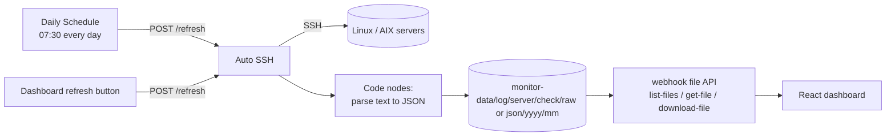

# n8n Server Monitoring

The n8n backend of [Automate Daily Monitoring](https://github.com/5kez/automate-daily-monitoring): workflows that SSH into Linux and IBM AIX servers every morning, run health-check commands, parse the output to JSON, store it by date, and serve it to a dashboard through a small webhook API.

Built during my Cloud Engineer internship at A-HOST Co., Ltd. (Nov 2025 – Mar 2026), as the sole developer. It cut the morning server check from 1–2 hours of manual work to about 5 minutes.

- Dashboard and live demo: [automate-daily-monitoring](https://github.com/5kez/automate-daily-monitoring) · [skez.codes/demo/monitoring](https://skez.codes/demo/monitoring/)
- Server names, IPs and credentials in this repo are anonymized (see the end of this page).

## How it works



## Workflows

| File | Trigger | What it does |
|---|---|---|
| `workflows/Daily_Schedule.json` | Schedule, 07:30 daily | Calls the `refresh` webhook so the full check runs before the team starts work |
| `workflows/Auto_SSH.json` | `POST /webhook/refresh` with `{"mode": "ALL"}` or one server name | Runs `df -h`, `top`, and Oracle tablespace queries on each server over SSH, converts the output to JSON in Code nodes, and saves both raw text and JSON under `/data/monitor/log/<server>/<check>/{raw,json}/<yyyy>/<mm>/` (146 nodes) |
| `workflows/webhook_file.json` | `GET /webhook/list-files`, `get-file`, `download-file` | The read API the dashboard uses: lists saved files, returns one as JSON, or downloads the raw file |
| `workflows/Auto_tunning.json` | `POST /webhook/tuning/upload` | Takes an uploaded Oracle top-20 SQL report (HTML) and execution plan files, matches them by `SQL_ID` and returns tuning recommendations |

## Custom node: AIX Topas RAW

`custom-nodes/n8n-nodes-aix/` is an n8n node written in TypeScript with `ssh2`.

The built-in SSH node could not capture `topas` on IBM AIX: `topas` is interactive and refuses to run without a terminal. This node opens its own SSH session, sets `TERM` inside the command, reads the stream for a fixed time (`captureMs`) and returns the raw screen text for a Code node to parse.

```bash
cd custom-nodes/n8n-nodes-aix
npm ci
npm run build        # compiles to dist/, which n8n loads through N8N_CUSTOM_EXTENSIONS
```

## Run it

Requires Docker with Compose.

```bash
cd custom-nodes/n8n-nodes-aix && npm ci && npm run build && cd ../..
cd deploy
echo "N8N_ENCRYPTION_KEY=$(openssl rand -hex 24)" > .env
docker compose up -d          # n8n behind Nginx on http://localhost:5678
```

Then in n8n:
1. Import the four files in `workflows/`.
2. Create one SSH credential per server. The exported credentials are placeholders with the id `REPLACE_ME`.
3. Activate `Daily Schedule`, `Auto SSH` and `webhook file`.

Results are written to `deploy/monitor-data/`.

## Deployment notes

- n8n runs behind an Nginx reverse proxy (`deploy/nginx/nginx.conf`), with long proxy timeouts because a full SSH run takes a few minutes.
- The encryption key comes from `.env` and is never committed.
- In production, the servers were reached through a FortiClient SSL VPN on the n8n host.

## Anonymization

This is a public copy of internal work:
- Server names are neutral (`DB-01`, `APP-01`, `DOCS-01`, `HELPDESK-01`, ...) and match the dashboard and its sample data.
- IPs, hostnames, credential IDs and the n8n encryption key are removed. `n8n.local` stands in for the real host.

## Stack

n8n · Docker Compose · Nginx · SSH · Linux · IBM AIX · Oracle · JavaScript · TypeScript

## Author

Tham Kaeoket · [skez.codes](https://skez.codes) · [LinkedIn](https://www.linkedin.com/in/tham-kaeoket/) · [github.com/5kez](https://github.com/5kez)
